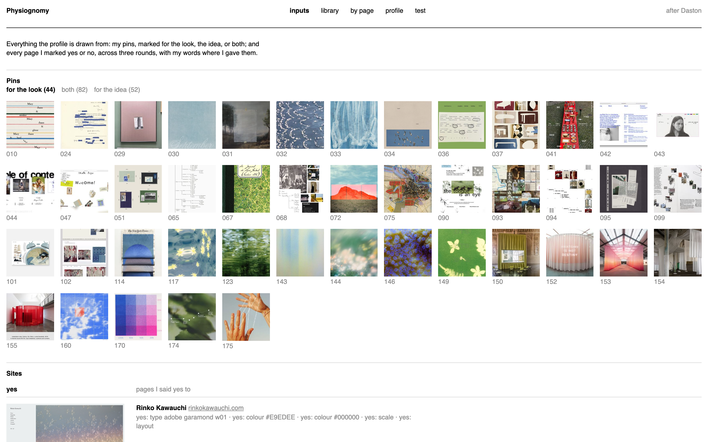
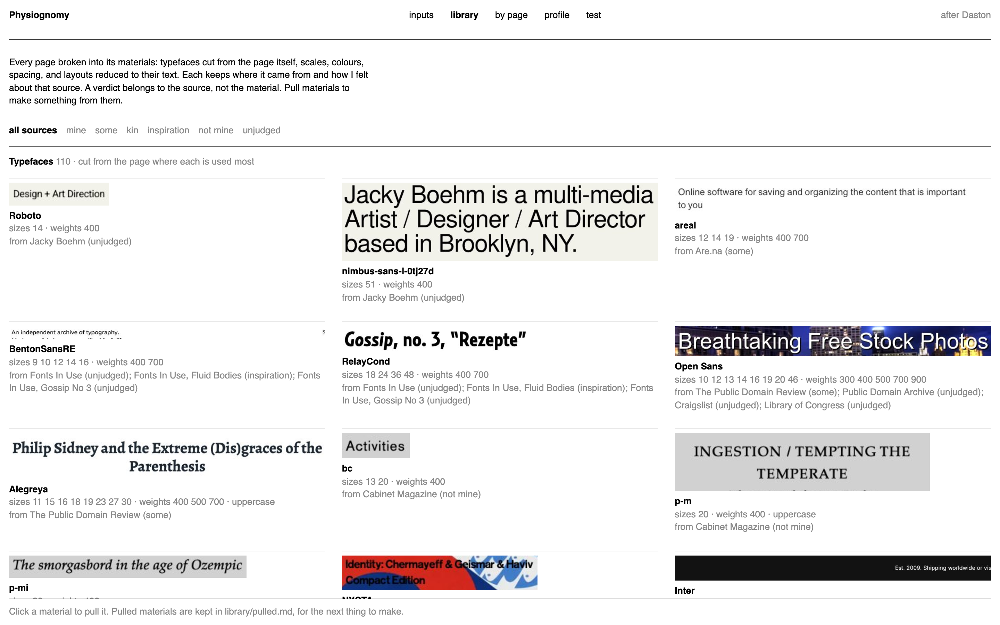

# Physiognomy

A small, local tool that learns your visual taste from references you like and dislike, and writes it
down as a profile you (or an agent) can read before making anything visual. It captures real web
pages, breaks each one into materials (typefaces, type scales, colours, spacing, layouts), and keeps
your yes and no on the page and on each material separately.

Made by [**Caseysimone Ballestas**](https://caseysimone.com), a graduate student in mechanical
engineering at UC Berkeley.



*The inputs: references marked for the look, the idea, or both. The images are other people's work;
that's the point. Taste is a relation to other people's work, not a thing of its own.*

**At a glance**

- Python 3 and a local web page; no accounts, no server beyond `127.0.0.1`, no database.
- Captures pages with the Google Chrome already installed, headless, in a throwaway profile.
- Every answer is written to plain Markdown you can read and edit by hand.
- macOS for the optional image nearness (Apple's Vision framework); everything else runs anywhere
  Chrome and Python do.
- In progress. This is a working research instrument, not a finished app.

---

## why

The name is after Lorraine Daston's *Cloud Physiognomy*: describing what flummoxes description.
Taste isn't discrete, but we still try to describe it, and we land on discrete things anyway.
This tool tries to keep that attempt honest.

**Taste isn't a mean.** Averaging what you like gives you a brand guide, not a taste.
So the profile keeps groups that hold together, ranges, what recurs, and edges, never one average.

**A verdict belongs to the source, not the material.** Liking a page doesn't mean liking its
typeface. You judge the page, and then each of its materials, separately.

**A library, not a set of exemplars.** A design made from a profile of three favourite sites tends to
copy one of them. Instead, every page is broken into materials, each kept with where it came from,
and a new design pulls a few across sources, on purpose, and records what it pulled.

---

## credit: PseudoClient

The design of this tool owes most to **PseudoClient** (David Chuan-En Lin and Nikolas Martelaro,
"Learning Personal Style from Few Examples," DIS 2021), which learns a model of a person's graphic
design style from a handful of positive and negative examples. What came from it:

- **Learning from a handful of yes and no.** PseudoClient works from as few as five liked and five
  disliked examples. Physiognomy is built the same way: you mark pages yes or no, a round at a time,
  rather than describing your taste in words or ratings.
- **Its four principles,** as I read the paper: learn by example, from a handful, by juxtaposition,
  by many comparisons. They're why the judging page and the plate put captured pages side by side,
  and why the tool asks for many small judgments instead of a few big ones.
- **Nearness.** `nearness.py` follows PseudoClient's idea of turning each image into a vector and
  measuring a new example against the ones you liked (here, the median distance to each liked page,
  never to their average). It uses Apple's Vision feature prints, untrained, where PseudoClient
  trains its model on your examples; that step is not here, and without it nearness is at chance
  (see below).

Where it departs, in answer to what I took to be PseudoClient's limits: it reads each page's real
CSS, so it sees typefaces; it keeps your words with each reference, so it holds meaning as well as
look; it breaks pages into materials, each judged on its own; and it writes a profile a person can
read, where PseudoClient's model is a classifier. Any errors in carrying the ideas over are mine.

---

## quick start

Requires Python 3 with Pillow (`pip install pillow`) and Google Chrome.

```bash
git clone https://github.com/caseysimoneb/physiognomy.git
cd physiognomy
mkdir -p taste
printf 'Example | https://example.com\n' > taste/sites.txt   # one "name | url" per line
cd taste && python3 ../capture.py plate-1 sites.txt && cd ..
python3 library.py               # breaks every capture into materials
python3 judge.py plate-1          # builds the judging page for that round
python3 serve.py plate-1         # then open http://127.0.0.1:8741/judge, and /view
```

Your data lives in `taste/` beside the code (ignored by git). Name each round's folder `plate-…`; the library reads every one. To keep it somewhere else, make a
`mine.py` beside `paths.py` that sets `DATA` (see [`paths.py`](paths.py)).

---

## what it does

| | |
|---|---|
| [`capture.py`](capture.py) | captures sites: a picture of the first screen and, at the same moment, its measured type, colour, and spacing. Sites that block headless browsers are reported, not worked around. |
| [`library.py`](library.py) | breaks every captured page into materials, each with its provenance; a new kind of material joins by adding an extractor to `KINDS` |
| [`judge.py`](judge.py) | a judging page for a round: each page large with yes / no, and its own materials beneath it, each with yes / no |
| [`plate.py`](plate.py) | a plate: captured sites side by side on one sheet, to loop and strike, and what the marks measure |
| [`view.py`](view.py) | the view at /view: inputs, the library, each page's values (one paragraph per verdict, put together from the numbers by code, not by a model), the profile, and the tests |
| [`nearness.py`](nearness.py), [`featureprint.swift`](featureprint.swift) | nearness after PseudoClient: each image becomes a vector with Apple's Vision feature print; a page's nearness is its median distance to each thing you liked, never to an average; every run reports its own self-check |
| [`serve.py`](serve.py) | serves the pages on 127.0.0.1:8741 and writes each answer to Markdown |
| [`snap.py`](snap.py) | renders local pages to PNG, to check them before showing anyone |



*The library: materials cut from other people's pages, each kept with where it came from.*

---

## known limitations

- **Nearness is at chance.** With untrained Vision feature prints, the self-check came out at about
  0.5 on a few dozen judgments. Nothing is ranked by it. Next tries: nearness on the measured
  materials rather than pixels, or a small model fitted to your own yes and no once there are many.
- **Screenshots miss motion.** Animation, scrolling behaviour, and menus that become pages aren't
  captured yet.
- **Choosing what to pull is still by hand.** The tool lays out your taste; it doesn't yet help you
  choose which strands of it to use for a given thing.
- Some pages served by `serve.py` (/pins, /test, /capture) read files made by hand in the author's
  own data and won't appear until you make your own.

## privacy

Everything stays on your computer. Captures use a throwaway Chrome profile and decline consent
banners; nothing is sent anywhere except the page requests themselves.

## license

Code: MIT — see [`LICENSE`](LICENSE).

## references

- Lorraine Daston, "Cloud Physiognomy," *Representations* 135 (2016).
- David Chuan-En Lin and Nikolas Martelaro, "Learning Personal Style from Few Examples," DIS 2021
  ([doi:10.1145/3461778.3462115](https://doi.org/10.1145/3461778.3462115);
  [arXiv:2105.14457](https://arxiv.org/abs/2105.14457)).
